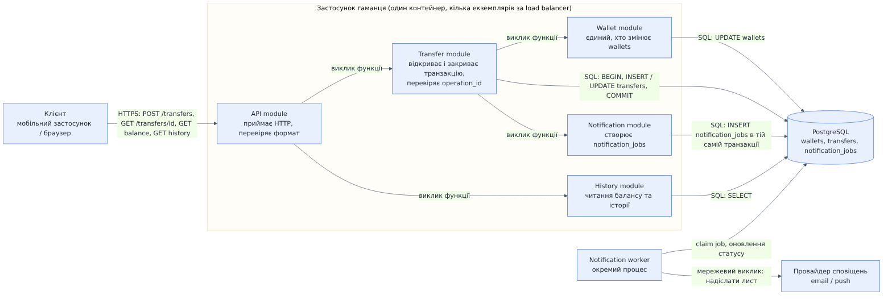
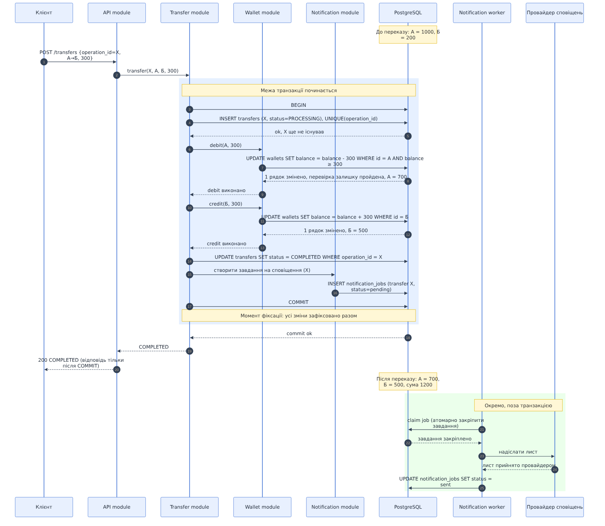
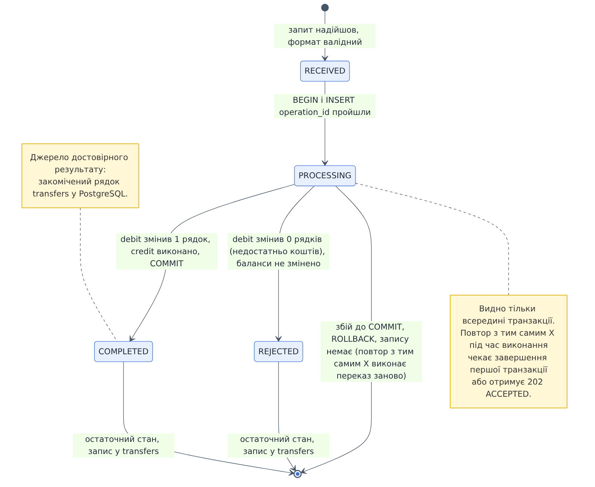
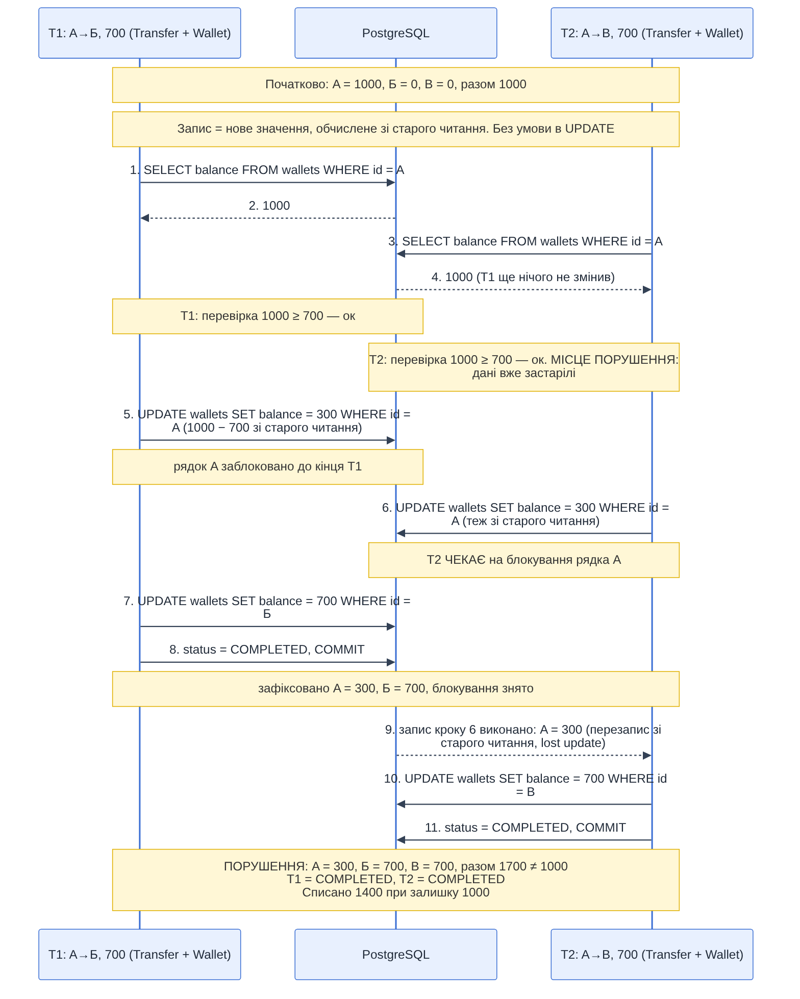
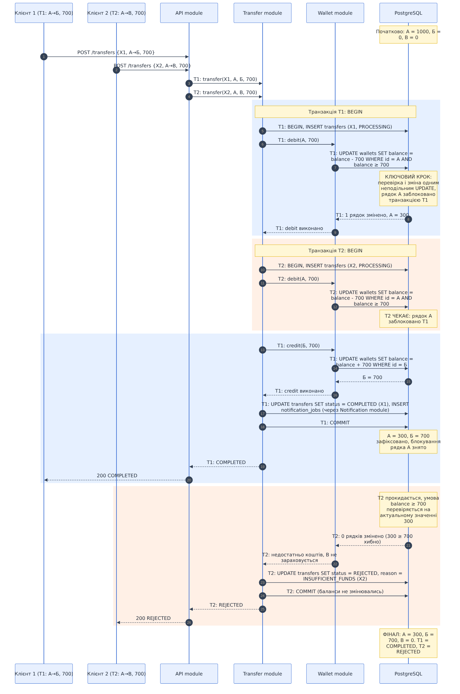

# Практична робота 1. Моделювання грошового переказу

**Автор:** Лютяниця Аніта Олександрівна
**Заявлений рівень:** 90
**Обраний варіант архітектури:** А - модульний моноліт

---

## 0. Вибір архітектурного варіанта

Команда з 6 розробників має 3 місяці й досвід із реляційними базами, але обмежений досвід розподілених систем. Ключове правило переказу (списання, зарахування й запис результату відбуваються разом) у моноліті забезпечується однією транзакцією бази даних, тому не потрібні протоколи узгодження між сервісами. Результат переказу завжди визначається одним закоміченим записом у `transfers`, і після timeout немає невизначеного стану між двома сховищами. Навантаження (1 000 переказів/с) можна обслужити кількома екземплярами застосунку зі спільною базою, а читання (4 000/с) прискорити окремо (індекси, кеш, read replica) - але не для рішення про списання. Межі між модулями (Transfer, Wallet, History) проводяться в коді, щоб за потреби винести їх пізніше.

**Головний мінус вибору:** одна спільна база може стати вузьким місцем (особливо «гарячі» рахунки), а реліз зачіпає весь застосунок. Це прийнятна ціна для першої версії; її треба вимірювати (lock wait, p95).

---

# 1. Структурна схема

**Пояснення схеми.**

- Рамка «Застосунок гаманця» — **один** застосунок. API, Transfer, Wallet, History, Notification — це **внутрішні модулі** (логічні межі), які викликають один одного звичайними викликами функцій, без мережі.
- **Окремими застосунками** (межа розгортання) є лише: Клієнт, Notification worker (окремий процес, що читає завдання з тієї самої бази) та зовнішній Провайдер сповіщень. Мережею є лише Клієнт → API та Worker → Провайдер.
- Власники даних: лише **Wallet module** змінює `wallets`; лише **Transfer module** керує транзакцією та записом у `transfers`; Notification module лише створює записи `notification_jobs`: його викликає Transfer module **всередині тієї самої транзакції** переказу.
- Провайдер сповіщень викликається **тільки worker-ом, після commit і поза транзакцією**, тому його недоступність не блокує переказ.
- Читання балансу та історії (History module) може бути прискорене індексами/кешем/репліками, але для рішення «чи вистачає коштів» використовується лише первинна база (в одному UPDATE).

## 2. Таблиця відповідальності

| Правило | Відповідальний компонент | Дані та постійне сховище | Запропонований механізм забезпечення |
|---|---|---|---|
| **1. Захист від від'ємного балансу** | Wallet module | Таблиця `wallets(id, balance)` у PostgreSQL | Atomic conditional update: `UPDATE wallets SET balance = balance - :sum WHERE id = :from AND balance >= :sum`. Якщо змінено 0 рядків — відмова (REJECTED). Додатково `CHECK (balance >= 0)` як друга лінія захисту. |
| **2. Атомарність списання і зарахування** | Transfer module (власник транзакції) | `wallets`, `transfers`, `notification_jobs` в одній базі PostgreSQL | **Межа транзакції:** від `BEGIN` до `COMMIT`. Усередині: INSERT `transfers` (operation_id), debit, credit, UPDATE статусу `COMPLETED`, INSERT `notification_jobs` (через виклик Notification module). Помилка на будь-якому кроці → `ROLLBACK` усього. Момент фіксації — `COMMIT`. |
| **3. Захист від повторного виконання** | Transfer module | `transfers.operation_id` з обмеженням `UNIQUE` у PostgreSQL | Перший крок транзакції — INSERT із `operation_id`. Якщо такий уже є — нове виконання не запускається, повертається збережений результат. Якщо перша спроба ще не закомічена, INSERT повтору **чекає** на унікальному індексі: після її COMMIT отримує конфлікт і повертає збережений результат, після ROLLBACK — виконує переказ сам. Тому навіть два одночасні повтори дають одне списання. Якщо параметри повтору (сума, отримувач) не збігаються зі збереженими → `409 Conflict`. Operation_id генерує клієнт і не змінює його при повторі. |
| **4. Збереження результату після перезапуску** | Transfer module + PostgreSQL | Рядок `transfers(operation_id, from_id, to_id, amount, status, reason, created_at)` у постійній базі | Статус `COMPLETED`/`REJECTED` комітиться разом зі зміною балансів. Після перезапуску результат знаходиться через `GET /transfers/{operation_id}`. Довговічність забезпечує WAL бази даних. |

---

## 3. Діаграма послідовності переказу

Приклад: A → Б, 300 грн; до переказу A = 1000, Б = 200.

**Що важливо на діаграмі:**

- **Перевірка залишку** і **зміна балансу** — один крок (умовний UPDATE), а не «прочитав → перевірив → записав».
- **Межа транзакції:** `BEGIN` → `COMMIT`. **Момент фіксації:** `COMMIT`. До нього зміни не існують для інших; після нього існують усі разом.
- **Відповідь клієнту** «COMPLETED» надсилається лише після `COMMIT`.
- **Сповіщення** виконує worker після commit і поза транзакцією. «Лист прийнято провайдером» не означає доставку у скриньку.
- **Числова перевірка:** до — A 1000, Б 200 (разом 1200); після — A 700, Б 500 (разом 1200). Збережено один завершений переказ на 300 грн.

## 4. Модель станів операції

### Стани та переходи

| Стан          | Що означає                                                        | Остаточний? | Зберігається в БД?                        |
| ------------- | ----------------------------------------------------------------- | ----------- | ----------------------------------------- |
| RECEIVED      | Запит прийнято API, формат перевірено                             | ні          | ні (логічний)                             |
| PROCESSING    | Відкрита транзакція виконує debit/credit                          | ні          | видно лише всередині транзакції до COMMIT |
| **COMPLETED** | Гроші переміщено, зміни зафіксовано                               | **так**     | **так** (`transfers.status`)              |
| **REJECTED**  | Відмова (недостатньо коштів / невалідні дані), баланси не змінено | **так**     | **так** (`transfers.status`, `reason`)    |

| Перехід | Подія | Що зберігається |
|---|---|---|
| RECEIVED → PROCESSING | `BEGIN` + INSERT `operation_id` без конфлікту | рядок `transfers` (у транзакції) |
| PROCESSING → COMPLETED | debit = 1 рядок, credit виконано, **COMMIT** | нові баланси + `status=COMPLETED` + `notification_jobs` |
| PROCESSING → REJECTED | debit = 0 рядків | `status=REJECTED, reason=INSUFFICIENT_FUNDS`, баланси без змін |
| PROCESSING → (запису немає) | збій до COMMIT, ROLLBACK | нічого — ніби запиту не було |

### Джерело достовірного результату

**Закомічений рядок у `transfers` у PostgreSQL.** Не відповідь клієнту, не кеш, не логи.

### Стан у системі vs що знає клієнт

| Що сталося | Реальний стан у системі | Що знає клієнт |
|---|---|---|
| Клієнт отримав `200 COMPLETED` | COMPLETED | COMPLETED (збігається) |
| Відповідь загубилась (timeout) | COMPLETED, або REJECTED, або запису немає | **невідомо** |
| Клієнт повторив запит з тим самим X | не змінився | отримує реальний результат із БД |
| Повтор прийшов, поки перша спроба ще виконується | PROCESSING (видно лише всередині транзакції першої спроби) | INSERT повтору чекає на унікальному індексі до COMMIT/ROLLBACK першої спроби. Після COMMIT отримує збережений результат, після ROLLBACK виконує переказ сам. Якщо очікування довше за дедлайн → `202 ACCEPTED`: «результат ще не зафіксовано, повторіть з тим самим ID» |

`GET /transfers/X` до COMMIT повертає `404` («результат невідомий»), бо запис ще не зафіксовано. Тому достовірно дізнатися результат клієнт може лише повтором з тим самим ID або після COMMIT.

**Ключове:** timeout відповіді сам по собі не визначає результат переказу — його визначає лише зафіксований запис у БД. `ACCEPTED` означає «прийнято в обробку», а не «гроші переміщено».

---

## 5. Діаграма помилкового виконання (race condition)

**Умови:** A = 1000, Б = 0, В = 0. T1: A→Б 700, T2: A→В 700. Алгоритм: прочитати → перевірити → списати → зарахувати → зберегти; захисту між перевіркою і зміною немає.

**Спосіб запису (явно):** запис **значення, розрахованого зі старого читання** (`SET balance = 300`, де 300 = 1000 − 700 обчислено в застосунку). Це класичний *lost update*.

### Покрокова трасування

| Крок | Дія | A у БД (закомічено) |
|---|---|---|
| 1–2 | T1 читає A → 1000 | 1000 |
| 3–4 | T2 читає A → 1000 | 1000 |
| — | T1: 1000 ≥ 700 — ок | 1000 |
| — | T2: 1000 ≥ 700 — ок (**дані вже застарілі**) | 1000 |
| 5 | T1 записує A = 300; рядок A заблоковано до кінця T1 | 1000 (300 у незакоміченій T1) |
| 6 | T2 записує A = 300 → **чекає на блокування рядка A** | 1000 |
| 7 | T1: Б = 0 + 700 | 1000 |
| 8 | T1: записує COMPLETED і робить COMMIT, блокування знято | 300 |
| 9 | Запис T2 з кроку 6 виконується: A = 300 (**перезапис значенням зі старого читання**) | 300 |
| 10 | T2: В = 0 + 700 | 300 |
| 11 | T2: записує COMPLETED і робить COMMIT | 300 |

Блокування рядка при записі не рятує: T2 лише чекає, а потім записує значення, яке вже обчислила зі старого читання. Перевірка і запис розірвані в часі.

### Результат і порушені правила

- **Остаточні баланси:** A = **300**, Б = **700**, В = **700**.
- **Результати:** T1 = COMPLETED, T2 = COMPLETED.
- Було 1000 грн, стало 1700 грн: 700 грн з'явилось з нічого.
- **Порушено правило 1** («не можна витратити більше, ніж маєш»): відправлено 1400 грн при залишку 1000.
- **Порушено правило 2** («списання і зарахування на однакову суму»): для T2 зарахування 700 на В відбулося, а її списання фактично затерте (lost update), тож A зменшився лише на 700 замість 1400.
- **Чому commit не врятував:** кожна транзакція окремо «правильна»; на рівні READ COMMITTED звичайне читання не блокує рядок, тому перевірка і зміна розірвані в часі, і між ними вклинився інший запит.

## 6. Виправлена sequence diagram

**Ті самі T1, T2 і числа** (A = 1000, 700, 700). **Механізм:** atomic conditional update — перевірка `balance ≥ 700` і списання виконуються одним UPDATE; PostgreSQL автоматично ставить блокування (row lock) на рядок A до кінця транзакції. Рівень ізоляції — `READ COMMITTED`.

### Пояснення до виправленої діаграми

Захист забезпечує **atomic conditional update**, який виконує PostgreSQL (row lock на рядок гаманця A) за викликом Wallet module. Крок 7 об'єднує перевірку `balance ≥ 700` і списання в одну неподільну операцію, тому T2 не може перевірити застарілий баланс: на кроці 12 він чекає, доки T1 тримає блокування рядка A. Після `COMMIT` транзакції T1 (крок 18) T2 перевіряє умову на актуальному значенні 300 (крок 21), отримує 0 змінених рядків і завершується зі статусом REJECTED, тож успішний лише один переказ (A = 300, Б = 700, В = 0). Недолік механізму: запити до одного гаманця виконуються послідовно, тому «гарячий» рахунок стає вузьким місцем (T2 чекає, росте latency); також можливий deadlock, якщо два перекази блокують два гаманці в різному порядку (A→Б і Б→A), тому гаманці слід блокувати в одному порядку, наприклад за id.

### Нумерація кроків (автонумерація стрілок діаграми)

| № | Що відбувається |
|---|---|
| 1–2 | Клієнти надсилають X1 і X2 в API module |
| 3–4 | API module передає обидва запити в Transfer module |
| 5 | T1: BEGIN, INSERT transfers (X1) |
| 6–7 | T1: debit → UPDATE з умовою `balance ≥ 700` (**тут ставиться row lock на A**) |
| 8–9 | T1: 1 рядок змінено, A = 300; debit виконано |
| 10 | T2: BEGIN, INSERT transfers (X2) |
| 11–12 | T2: debit → той самий UPDATE; **T2 чекає** блокування |
| 13–16 | T1: credit, Б = 700 |
| 17 | T1: transfers X1 = COMPLETED + notification_job (через Notification module) |
| 18 | T1: **COMMIT**, блокування знято |
| 19–20 | Клієнт 1 отримує COMPLETED через API module |
| 21 | T2: умова перевіряється на актуальному A = 300 → **0 рядків** |
| 22–24 | T2: відмова, X2 = REJECTED, COMMIT без змін балансів |
| 25–26 | Клієнт 2 отримує REJECTED через API module |

## 7. Таблиця перевірки

| Сценарій | Початкові дані | Порядок дій або точка збою | Очікувані баланси та статуси | Механізм захисту |
|---|---|---|---|---|
| **1. Два різні перекази по 700 грн** | A = 1000, Б = 0, В = 0. X1: A→Б 700, X2: A→В 700 | T1 і T2 надходять одночасно; T1 першим бере блокування рядка A; T2 чекає до COMMIT T1 | A = **300**, Б = **700**, В = **0**. X1 = COMPLETED, X2 = REJECTED (INSUFFICIENT_FUNDS). Одне списання 700 | Atomic conditional update (`WHERE balance ≥ 700`) + row lock на рядок A |
| **2. Повтор завершеного переказу з тим самим ID після втрати відповіді** | A = 1000, Б = 0. X: A→Б 300 виконано (A = 700, Б = 300), але відповідь клієнту загубилась | Клієнт повторює `POST /transfers` з тим самим X | A = **700**, Б = **300** (**нового списання немає**). Повертається попередній результат COMPLETED. У `transfers` один запис X | `UNIQUE(operation_id)`: повторний INSERT дає конфлікт → повертається збережений результат |
| **3. Збій після списання, але до commit** | A = 1000, Б = 0. Переказ X: A→Б 300 | Debit виконано (усередині транзакції A = 700), сервер падає до `COMMIT` | Після відновлення: A = **1000**, Б = **0**. Запису X у `transfers` немає взагалі (INSERT був у тій самій транзакції і відкотився), клієнт не отримував «успішно». Повтор із тим самим X виконається заново: A = 700, Б = 300 | Атомарність транзакції: некомічені зміни відкочуються; відповідь клієнту лише після COMMIT |

Сценарії 1 і 2 перевіряють **різні** механізми: у першому — **різні** запити одночасно (конкурентність), у другому — **той самий** запит двічі (idempotency). Один механізм не замінює інший.

### Збереження даних після перезапуску

При `COMMIT` PostgreSQL спочатку записує зміни у журнал (WAL) на диск і лише потім підтверджує успіх. Після перезапуску СУБД відтворює закомічені зміни з журналу та відкочує незакомічені. Тому статус `COMPLETED` у `transfers` і нові баланси не зникають, а хибного успіху без запису бути не може. Завдання на сповіщення (`notification_jobs`) створюється в тій самій транзакції, тож після збою між commit і відправкою листа worker повторно прочитає незавершені завдання; можливі дублікати листів потребують окремого захисту (idempotency key провайдера).
